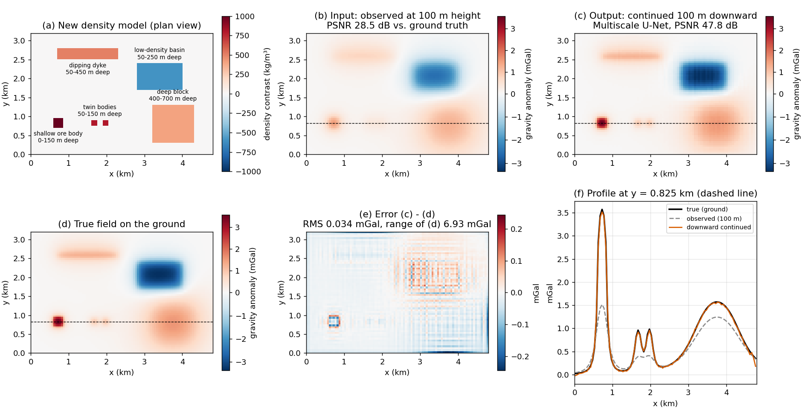
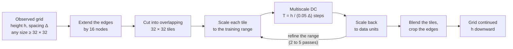
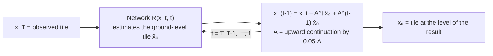

# Multiscale Learning for Downward Continuation of Gravity Data

Code, test data and evaluation notebooks for the paper

> An earlier version of this work is available as a preprint: *Cold-Diffusion Driven Downward Continuation of Gravity
> Data*, [arXiv:2510.21191](https://doi.org/10.48550/arXiv.2510.21191).

This repository reproduces every entry of **Table 2** (synthetic data) and **Table 3** (field data) of the
paper: 14 approaches, 4 metrics each, mean ± standard deviation to 4 decimals. The pretrained weights
(16 files, about 12 GB) and the synthetic datasets (the training sets of both tables and the synthetic test
set, about 360 MB) are archived on Zenodo: **DOI [10.5281/zenodo.24340552](https://doi.org/10.5281/zenodo.24340552)**.

Table 2 can be reproduced from this repository and the weights alone. The field data of Table 3 cannot be
redistributed and are not included (see [Data](#data)); for Table 3 the repository provides the code, the
weights, the per-patch metrics of every row and checksums of the 10 test patches, so that the table can be
reproduced exactly with the data.

The pretrained networks can also be applied to **your own gravity data**: the `multiscale_dc` package
continues any gridded gravity anomaly downward in one call (see
[Use the networks on your own data](#use-the-networks-on-your-own-data)).

## Quick start

```bash
git clone https://github.com/adarshjcreation/Multiscale-DC.git
cd Multiscale-DC
conda create -n gravdc python=3.11 -y && conda activate gravdc
pip install -r requirements.txt
python scripts/download_weights.py      # about 12 GB from Zenodo, every file MD5-checked
bash scripts/run_all.sh                 # Table 2: about 5 minutes on an RTX 3090 (Table 3: see below)
python scripts/download_data.py         # optional: the synthetic datasets, into datasets/ (see Datasets)
```

`scripts/run_all.sh` executes the notebooks with the Jupyter kernel `python3`. If your environment is
registered under another kernel name, run `KERNEL=<name> bash scripts/run_all.sh` (register the
environment with `python -m ipykernel install --user --name gravdc`). The notebooks can also be run by hand,
01 to 10 and then 00, in each of the two folders.

`scripts/run_all.sh` runs Table 3 as well (about 8.5 more minutes) when the 10 field test patches are in
`table3_field/data/test`; `python table3_field/scripts/check_data.py` checks them against their MD5 checksums.
Without the data, Table 3 is skipped.

Every notebook prints its result next to the value in the paper. The last notebook of each folder
(`00_Reproduce_Table2.ipynb`, `00_Reproduce_Table3.ipynb`) assembles the table, marks a row with ✓ when all
four metrics (mean and standard deviation) agree with the paper to 4 decimals, and writes
`results/table2.md` / `results/table3.md` (and `.csv`).

## Use the networks on your own data

The `multiscale_dc` package applies the pretrained multiscale networks to any gridded gravity anomaly, of
any size and in any unit. Run the commands in the repository folder (or add the folder to `PYTHONPATH`):

```bash
python scripts/download_weights.py --table 3     # the field weights, used by default (about 6 GB)
python -m multiscale_dc examples/data/example_obs_h100m.csv --spacing 50 --height 100 --plot result.png
```

The same in Python:

```python
from multiscale_dc import downward_continue, load_grid, save_grid

g_obs = load_grid("examples/data/example_obs_h100m.csv")  # 64 x 96 nodes, mGal, 50 m spacing, observed 100 m up
g_0 = downward_continue(g_obs, spacing=50, height=100)     # continued 100 m downward: same shape and unit
save_grid("example_ground.csv", g_0)
```

### Example



**(a)** A new 3-D density model, not part of any training or test set: 64 x 96 x 16 cells of 50 m with six
bodies of positive and negative density contrast. Its gravity anomaly was computed with the exact prism
formula **(b)** 100 m above the ground (the input) and **(d)** on the ground (the truth). **(c)** The Multiscale
U-Net continues the observations 100 m downward. **(f)** It recovers the amplitude of the shallow ore body and
separates the twin bodies, 150 m apart, which merge into one anomaly at 100 m height. PSNR against the truth
(without the outer 4 nodes) rises from 28.5 dB for the observations to 47.8 dB. Reproduce with
`python examples/new_grid_example.py`; it also writes the input grid used in the commands above.

### How it works



Inside "Multiscale DC" (the Stabilized DC routine of the paper), for each tile:



* **Tiles.** The networks were trained on 32 x 32 grids. A larger grid is extended by 16 nodes on every side
  (values ramping linearly to the median of the grid, against edge effects), cut into 32 x 32 tiles every 8
  nodes, and put back together with smooth (Hann) weights, which favour the centre of each tile.
* **Scaling.** Each training grid was scaled to [-1, 1] at ground level. For new data that range is not known;
  it is estimated from the observations and refined over a few passes (2 for the U-Net, 5 for the DiT). The
  result is in the unit of the input, and a constant added to the input is added unchanged to the result.
* **Steps.** One network step is an upward continuation by 0.05 grid spacings; continuing by `height` takes
  `height / (0.05 x spacing)` steps, at most 40 (2 grid spacings, as in training). Only the ratio height /
  spacing matters, so the same networks serve a 50 m grid at 100 m height and a 400 m grid at 800 m height.

### Inputs, outputs and options

| Python argument | Command line | Meaning | Default |
|---|---|---|---|
| `grid` | input file | gravity anomaly at the observation level on a regular grid (rows = y, columns = x), same spacing in x and y, at least 32 x 32 nodes, no gaps; any unit (mGal, µm/s²). Files: `.npy`, `.csv` / `.txt` (one grid row per line), `.mat` (variable `--var`) | required |
| `spacing` | `--spacing` | grid spacing, e.g. in m | required |
| `height` | `--height` | continuation distance, in the unit of the spacing: the observations lie this far above the level of the result. At most 2 x spacing, in steps of 0.05 x spacing | required |
| `model` | `--model` | `multiscale_unet` or `multiscale_dit` | `multiscale_unet` |
| `weights` | `--weights` | `field` (trained on positive and negative density contrasts; Table 3) or `synthetic` (positive contrasts only; Table 2) | `field` |
| `routine` | `--routine` | `stabilized`, `single-shot` (one network evaluation, fastest) or `recursive` | `stabilized` |
| `passes` | `--passes` | number of scaling passes | 2 (U-Net), 5 (DiT) |
| `stride` | `--stride` | step between the tiles, in nodes (smaller: smoother, slower) | 8 |
| `pad` | `--pad` | edge extension in nodes (0: off) | 16 |
| `device` | `--device` | `cuda` or `cpu` | `cuda` if available |
| returns | `-o` | the downward-continued grid, same shape and unit as the input (`.npy` or `.csv`) | `<input>_dc.npy` |
| – | `--plot` | figure of the input and the result (PNG) | – |

Two helpers are useful for checks and tests: `multiscale_dc.upward_continue_grid(g_0, spacing, height)`
continues a result back up, which should give back the observations, and
`multiscale_dc.forward.grid_gravity(model, cell, height)` computes the exact gravity of a 3-D density model,
as in the example. `python -m multiscale_dc --help` lists all options.

### Accuracy and limitations

* **Accuracy.** We tested the tool on observations computed with the exact prism formula, not with the
  continuation operator of the networks. PSNR against the true ground-level field (without the outer 4 nodes),
  default settings:

  | Test | Observations | Multiscale U-Net (default) | Multiscale DiT |
  |---|---|---|---|
  | 10 density models of the Table-2 test set, positive contrasts | 19.2 dB | **35.8 dB** | 34.0 dB |
  | the same models with negative contrasts | 19.2 dB | **35.7 dB** | 33.5 dB |
  | the example above (64 x 96 nodes) | 28.5 dB | **47.8 dB** | 44.6 dB |

  All with field weights, continued 100 m (2 grid spacings) downward. These numbers are not comparable with
  Table 2, where the observations are computed with the continuation operator itself.
* **Height.** At most 2 grid spacings. For a larger continuation distance, first resample the grid to a
  spacing of at least `height / 2`.
* **Noise.** The networks were trained on noise-free data, and downward continuation amplifies
  short-wavelength noise. On the 10 test models (Multiscale U-Net), smooth (spatially correlated) noise of
  2 % of the data range still left a clear gain (19.2 → 24.9 dB), and so did uncorrelated noise of 0.5 %
  (19.2 → 22.2 dB), but uncorrelated noise of 2 % made the result worse than the observations
  (19.2 → 13.8 dB). Low-pass filter noisy grids before the continuation.
* **Geology.** Downward continuation is valid only above all sources: the level of the result must lie above
  the shallowest source. The networks learned compact bodies down to 8 (field weights) or 16 (synthetic
  weights) grid spacings below that level.
* **Edges.** The outermost few nodes are the least accurate, even with the edge extension.
* **Runtime.** On an RTX 3090 the 64 x 96 example takes 16 s with the Multiscale U-Net and about 4 minutes
  with the Multiscale DiT (larger network, 5 passes). On a CPU, a 32 x 32 grid takes about a minute with the
  U-Net, with the same result as on the GPU (to 4 x 10⁻⁶ of the data range).

## Repository layout

```
table2_synthetic/             Table 2: 10 synthetic test grids (32 x 32 nodes, 50 m spacing), 100 m continuation
table3_field/                 Table 3: 10 field test patches (32 x 32 nodes, 400 m spacing), 800 m continuation
    data/test/                  test grids (.mat files, variables d and m); the field data are not included
    gravdc/                     Python package: forward operators, metrics, classical methods, samplers, networks
    notebooks/                  01-10: one notebook per approach; 00: assembles and checks the table
    results/                    per-grid metrics of every row (JSON) and the assembled table (md, csv)
    weights/                    pretrained weights, downloaded from Zenodo (see weights/README.md)
    scripts/                    run_all.sh, check_weights.py (table3_field also check_data.py and
                                train_physics_trained.py)
    README.md                   protocol, methods and reproducibility checks of this table in detail
multiscale_dc/                apply the pretrained networks to new gravity grids (Python and command line)
    forward.py                  exact gravity of a 3-D density model (rectangular prisms), for test data
examples/new_grid_example.py  example on a new density model; writes examples/data/ and docs/new_grid_example.png
scripts/download_weights.py   downloads and checks the weights of both tables
scripts/download_data.py      downloads the synthetic datasets into datasets/ (optional)
scripts/run_all.sh            runs both folders
requirements.txt              exact package versions
```

The two folders are self-contained: each has its own copy of the `gravdc` package with the settings of its
data set (grid spacing, continuation height and method parameters), and each runs on its own.

## Results

Output of the notebooks (`results/table2.md`, `results/table3.md`). Bold: best value of each column.
Row names follow the paper; in `results/` and in the notebooks, Backbone U-Net is called `U-Net`.

### Table 2: synthetic data

| Approach | PSNR (dB) ↑ | SSIM ↑ | RE ↓ | RMSE ↓ |
|---|---|---|---|---|
| TTSIDC | 47.9276 ± 4.5850 | 0.9985 ± 0.0014 | 0.0135 ± 0.0077 | 0.0094 ± 0.0067 |
| Oracle TRDC | 37.0393 ± 1.9052 | 0.9761 ± 0.0082 | 0.0424 ± 0.0040 | 0.0282 ± 0.0066 |
| TRDC | 36.3714 ± 1.7217 | 0.9756 ± 0.0057 | 0.0457 ± 0.0039 | 0.0303 ± 0.0064 |
| DU-Net | 48.6022 ± 2.0723 | 0.9984 ± 0.0007 | 0.0113 ± 0.0018 | 0.0075 ± 0.0019 |
| DC-Net | 52.3368 ± 3.9071 | 0.9995 ± 0.0005 | 0.0078 ± 0.0034 | 0.0053 ± 0.0029 |
| Backbone U-Net | 57.8891 ± 3.3056 | 0.9999 ± 0.0001 | 0.0040 ± 0.0015 | 0.0027 ± 0.0013 |
| Physics-Trained | 26.9830 ± 1.0557 | 0.8539 ± 0.0810 | 0.1378 ± 0.0346 | 0.0878 ± 0.0101 |
| CNN-regularized | 50.7438 ± 8.5486 | 0.9982 ± 0.0040 | 0.0140 ± 0.0178 | 0.0102 ± 0.0140 |
| Denoising diffusion (U-Net) | 59.0080 ± 1.6162 | 0.9999 ± 0.0000 | 0.0034 ± 0.0004 | 0.0022 ± 0.0005 |
| Multiscale DiT (Single-shot) | 60.1563 ± 4.4481 | 0.9998 ± 0.0003 | 0.0033 ± 0.0020 | 0.0023 ± 0.0017 |
| Multiscale DiT (Stabilized DC) | **64.7164 ± 6.6262** | **0.9999 ± 0.0001** | **0.0023 ± 0.0022** | **0.0017 ± 0.0018** |
| Multiscale U-Net (Single-shot) | 58.9173 ± 3.9686 | 0.9998 ± 0.0001 | 0.0037 ± 0.0019 | 0.0025 ± 0.0016 |
| Multiscale U-Net (Stabilized DC) | 63.4603 ± 6.9387 | 0.9999 ± 0.0001 | 0.0028 ± 0.0029 | 0.0020 ± 0.0023 |
| Multiscale U-Net (Recursive DC) | 32.8412 ± 1.8151 | 0.9403 ± 0.0300 | 0.0723 ± 0.0245 | 0.0452 ± 0.0083 |

### Table 3: field data

| Approach | PSNR (dB) ↑ | SSIM ↑ | RE ↓ | RMSE ↓ |
|---|---|---|---|---|
| TTSIDC | 36.8247 ± 2.5611 | 0.9882 ± 0.0076 | 0.0746 ± 0.0243 | 0.0262 ± 0.0097 |
| Oracle TRDC | 40.9487 ± 2.7437 | 0.9910 ± 0.0051 | 0.0455 ± 0.0125 | 0.0160 ± 0.0055 |
| TRDC | 37.7190 ± 2.1283 | 0.9862 ± 0.0084 | 0.0656 ± 0.0176 | 0.0231 ± 0.0080 |
| DU-Net | 36.2222 ± 1.8690 | 0.9861 ± 0.0088 | 0.0768 ± 0.0144 | 0.0270 ± 0.0073 |
| DC-Net | 33.9575 ± 1.9905 | 0.9771 ± 0.0116 | 0.1003 ± 0.0208 | 0.0353 ± 0.0101 |
| Physics-Trained | 26.4089 ± 1.7020 | 0.8490 ± 0.1073 | 0.2391 ± 0.0506 | 0.0816 ± 0.0128 |
| CNN-regularized | 28.3958 ± 1.7156 | 0.9254 ± 0.0316 | 0.1888 ± 0.0293 | 0.0663 ± 0.0158 |
| Backbone U-Net | 32.4771 ± 1.9784 | 0.9724 ± 0.0142 | 0.1201 ± 0.0277 | 0.0421 ± 0.0119 |
| Denoising diffusion (U-Net) | 38.4493 ± 2.7439 | 0.9911 ± 0.0089 | 0.0618 ± 0.0214 | 0.0218 ± 0.0091 |
| Multiscale DiT (Single-shot) | 39.8545 ± 2.6601 | 0.9940 ± 0.0067 | 0.0525 ± 0.0181 | 0.0186 ± 0.0078 |
| Multiscale DiT (Stabilized DC) | 39.3045 ± 2.6594 | 0.9933 ± 0.0073 | 0.0561 ± 0.0197 | 0.0198 ± 0.0084 |
| Multiscale U-Net (Single-shot) | **41.8093 ± 3.0735** | **0.9953 ± 0.0069** | **0.0427 ± 0.0186** | **0.0152 ± 0.0078** |
| Multiscale U-Net (Stabilized DC) | 40.8483 ± 3.0420 | 0.9943 ± 0.0078 | 0.0478 ± 0.0203 | 0.0169 ± 0.0085 |
| Multiscale U-Net (Recursive DC) | 28.6774 ± 2.1266 | 0.9499 ± 0.0158 | 0.1836 ± 0.0362 | 0.0641 ± 0.0156 |

## Evaluation protocol

* **Ground truth**: 10 test grids per table, 32 x 32 nodes, each min-max scaled to [-1, 1].
* **Observation**: the ground truth continued upward, by 100 m (Table 2) or 800 m (Table 3).
  The multiscale models, TTSIDC and TRDC use the multiscale operator (40 continuations of 2.5 m or 20 m,
  each with zero padding to 36 x 36 and cropping back to 32 x 32); the other methods use a single
  continuation with zero padding to 36 x 36 (denoising diffusion in Table 3: 64 x 64, as in its training).
* **Metrics**: PSNR, SSIM, relative error and RMSE on the central 24 x 24 window (the outer 4 nodes are
  affected by FFT edge effects); mean ± standard deviation (ddof = 0) over all 10 test grids.
* **Networks**: raw training weights (no exponential moving average), full FP32 with deterministic cuDNN.
* **Denoising diffusion**: metrics of the posterior mean of 10 samples per grid; 250 reverse steps and
  seed 2 (Table 2), 500 reverse steps and seed 1 (Table 3). Notebook 08 also prints seeds 0-2.
* **Physics-Trained**: fitted to the test observations through the physics loss only; the ground truth is
  used only for evaluation. For Table 3, `table3_field/scripts/train_physics_trained.py` regenerates the
  released weights.

The README of each folder gives the parameters of every method and how they were chosen.

## Reproducibility

* `gravdc` switches PyTorch to full FP32 with deterministic cuDNN when it is imported
  (`gravdc/precision.py`). With PyTorch's default TF32 convolutions on Ampere and newer GPUs, the 3rd-4th
  decimal of the PSNR would depend on the GPU and on the cuDNN algorithm.
* Denoising diffusion, the only stochastic method, draws its noise from a seeded CPU random generator, so
  the noise is the same on every device.
* **Tested environment**: Python 3.11.6, PyTorch 2.9.0 with CUDA 12.8 and cuDNN 9.10, NVIDIA GeForce RTX
  3090 (24 GB), Linux; package versions in `requirements.txt`. Repeated runs from an empty `results/`
  folder gave bit-identical per-grid metrics, and all 28 rows matched the reference values
  (`gravdc/table2.py`, `gravdc/table3.py`).
* **Other hardware**: CPU and GPU kernels round differently. In a CPU-only run the classical methods give
  identical results, and the PSNR of the other rows differs from the reference by at most 0.004 dB
  (Table 2) and 0.0014 dB (Table 3), mostly in the multiscale rows, whose 40-step routines accumulate
  rounding differences; a few standard deviations differ in the last digit. On CPU, notebook 08 takes
  1-2 hours per table; everything else takes minutes.

## Data

* **Synthetic test grids** (`table2_synthetic/data/test`, also on Zenodo as `synthetic_test.zip`): 10
  synthetic grids of 32 x 32 nodes with 50 m spacing, with their density models (see Datasets below).
* **Field test patches** (Table 3): 10 patches of 32 x 32 nodes (400 m spacing) of the Bouguer gravity
  anomaly of the Mangampeta region (southern Cuddapah basin, Andhra Pradesh, India), provided by the
  Geological Survey of India (Ganguli et al., 2019). These data cannot be redistributed and are **not
  included**. `table3_field/data/README.md` lists the expected files and their MD5 checksums; with the data
  in `table3_field/data/test`, Table 3 reproduces exactly. Without them, `table3_field/results/` still
  holds the per-patch metrics of every row, from which `00_Reproduce_Table3.ipynb` assembles the table.
  The executed Table-3 notebooks contain no figures of the field data.
* **Training sets**: on Zenodo (below). They are not needed to reproduce the tables.

### Datasets on Zenodo

`python scripts/download_data.py` downloads the three archives, checks their MD5 and unpacks them into
`datasets/` (`python scripts/download_data.py synthetic_train` fetches one of them). The data are synthetic,
generated with the random-walk method of Huang et al. (2021); the original files are included unchanged.

| Dataset | Files | Grid spacing | Density contrast | Used for |
|---|---|---|---|---|
| `synthetic_train` | 22,000 | 50 m | +1.0 g/cm³ | training set of the Table-2 networks |
| `synthetic_test` | 10 | 50 m | +1.0 g/cm³ | test set of Table 2 (= `table2_synthetic/data/test`) |
| `field_train` | 22,000 | 400 m | −1.0, −0.5, +0.5, +1.0 g/cm³, 5,500 files each (`data0`–`data5499`, `data5500`–`data10999`, `data11000`–`data16499`, `data16500`–`data21999`) | training set of the Table-3 networks |

Each `data<i>.mat` file holds two variables:

* `d` (1,024 x 1, float64): the gravity anomaly in mGal on the 32 x 32 observation grid; the code reads it
  as `d.reshape(32, 32)` and scales each grid to [-1, 1] (`gravdc/data.py`).
* `m` (16,384 x 1, 16-bit integer): the density-contrast model in kg/m³ on 32 x 32 x 16 cells (zero outside
  the anomalous body); `m.reshape(16, 32, 32)[k]` is the k-th of the 16 layers (k = 0 at the top), on the
  same horizontal grid as `d.reshape(32, 32)`.

Cell size: 50 x 50 x 50 m in `synthetic_train` and `synthetic_test` (model down to 800 m depth), and
400 x 400 x 200 m in `field_train` (down to 3.2 km). The observation points lie at the cell centres of the top
face of the model; `d` is the exact gravity of the prisms there, which `multiscale_dc.forward.grid_gravity`
reproduces.

## Pretrained weights

The Zenodo record holds 8 files per table. Their names carry the prefix `synthetic_` (Table 2) or `field_`
(Table 3); `scripts/download_weights.py` stores them without the prefix in `table2_synthetic/weights/` and
`table3_field/weights/` and checks the MD5 of every file. If you downloaded the files by hand, put them in
place with `python scripts/download_weights.py --from-dir <folder>`. The `weights/README.md` of each folder
lists every file, the method it belongs to and its MD5.

## License

The code is released under the MIT License (see `LICENSE`). The pretrained weights and the synthetic
datasets on Zenodo are released under CC BY 4.0. The field data are not part of this repository or of the
Zenodo record and are not covered by these licenses.

## Citation

If you use this code, the pretrained weights or the datasets, please cite the paper. Until the journal
version is published, please cite the preprint of its earlier version:

> Jain, A., Bharadwaj, P., & Seelamantula, C. S. (2025). *Cold-Diffusion Driven Downward Continuation of
> Gravity Data*. arXiv preprint arXiv:2510.21191. https://doi.org/10.48550/arXiv.2510.21191

```bibtex
@misc{jain2025colddiffusion,
  title         = {Cold-Diffusion Driven Downward Continuation of Gravity Data},
  author        = {Jain, Adarsh and Bharadwaj, Pawan and Seelamantula, Chandra Sekhar},
  year          = {2025},
  eprint        = {2510.21191},
  archivePrefix = {arXiv},
  primaryClass  = {physics.geo-ph},
  doi           = {10.48550/arXiv.2510.21191},
  url           = {https://arxiv.org/abs/2510.21191}
}
```

If you use the pretrained weights or the datasets, please also cite the Zenodo record:

> Jain, A., Bharadwaj, P., & Seelamantula, C. S. (2026). *Pretrained weights and synthetic datasets for "Multiscale Learning for Downward Continuation of Gravity Data"* (Version 1.0) [Data set].
> Zenodo. https://doi.org/10.5281/zenodo.24340552

```bibtex
@misc{jain_multiscale_dc_zenodo,
  title     = {Pretrained weights and synthetic datasets for ``Multiscale Learning for Downward Continuation of Gravity Data''},
  author    = {Jain, Adarsh and Bharadwaj, Pawan and Seelamantula, Chandra Sekhar},
  year      = {2026},
  publisher = {Zenodo},
  version   = {1.0},
  doi       = {10.5281/zenodo.24340552},
  url       = {https://doi.org/10.5281/zenodo.24340552}
}
```
